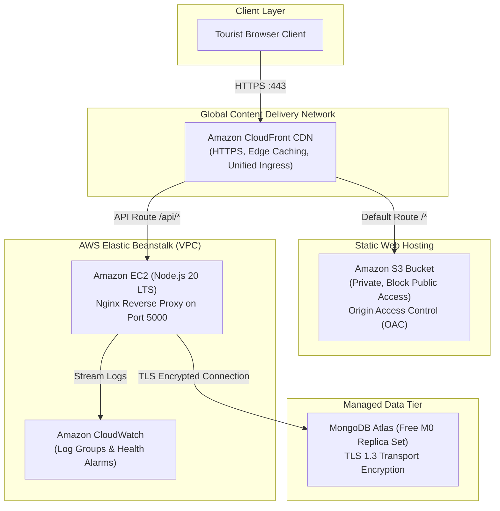

# Smart Tourism App — AWS Cloud Architecture Project

> A cloud-native, multi-tier travel destination discovery and personalized tourism recommendation system architected for Amazon Web Services (AWS) and MongoDB Atlas.

[](https://nodejs.org/)
[](https://react.dev/)
[](https://aws.amazon.com/)
[](LICENSE)

---

## 🏛️ Cloud Architecture Overview



---

## 📚 Documentation Suite

Comprehensive academic and technical documentation is located in the `docs/` directory:

| Document | Description |
| :--- | :--- |
| **[docs/architecture.md](docs/architecture.md)** | Deep architectural specification, request flow diagrams, component breakdown, and scalability trade-offs. |
| **[docs/deployment-guide.md](docs/deployment-guide.md)** | Step-by-step AWS deployment manual tailored for AWS Academy Learner Labs and standard AWS accounts. |
| **[docs/security.md](docs/security.md)** | Security architecture, IAM least-privilege policies, Origin Access Control (OAC), and secret handling. |
| **[docs/cost-analysis.md](docs/cost-analysis.md)** | Comprehensive financial analysis demonstrating **$0.00/month** deployment within AWS Free Tier limits. |
| **[docs/testing-report.md](docs/testing-report.md)** | Empirical test logs, automated backend test results (`node:test`), and build performance metrics. |
| **[docs/cloud-architecture-report.md](docs/cloud-architecture-report.md)** | Formal university academic project report ready for course evaluation. |

---

## 📁 Repository Structure

```
smart-tourism-app/
├── backend/
│   ├── config/db.js                 # Resilient MongoDB Atlas connection
│   ├── controllers/                # Business logic: auth, place, recommendation, admin
│   ├── middleware/                 # JWT authMiddleware (protect + adminOnly), errorMiddleware
│   ├── models/                     # Mongoose schemas: User, Place, Questionnaire
│   ├── routes/                     # Express routers: /api/auth, /api/places, /api/recommend, /api/admin
│   ├── seed/                       # Sample data & automated import scripts
│   ├── tests/                      # Automated cloud health & API test suite (node:test)
│   ├── .ebextensions/              # AWS Elastic Beanstalk Nginx & health check configuration
│   ├── Procfile                    # Elastic Beanstalk process definition
│   ├── server.js                   # Express server entry point with /health endpoints
│   ├── package.json
│   └── .env.example
│
├── frontend/
│   ├── src/
│   │   ├── api.js                  # Cloud-aware API client (auto-detects CloudFront / relative /api)
│   │   ├── App.jsx                 # React Router v7 root with Theme/Toast context
│   │   ├── components/             # Layout, PlaceCard, Icons, Spinner, FadeInSection, Toast
│   │   ├── pages/                  # HomePage, ExplorePage, RecommendPage, PlaceDetailPage, LoginPage
│   │   └── utils/images.js         # Curated Unsplash fallback images
│   ├── index.html
│   ├── vite.config.js
│   ├── package.json
│   └── .env.example
│
├── infrastructure/
│   └── cloudformation-frontend.yaml # AWS CloudFormation template for S3 + CloudFront + OAC
│
├── scripts/
│   ├── package-backend.ps1         # Windows PowerShell packaging script for Elastic Beanstalk
│   ├── package-backend.sh          # Linux/macOS/CloudShell packaging script for Elastic Beanstalk
│   ├── deploy-frontend.ps1         # Windows PowerShell build & S3/CloudFront deployer
│   └── deploy-frontend.sh          # Linux/macOS/CloudShell build & S3/CloudFront deployer
│
├── docs/                           # Full technical and academic documentation suite
├── .gitignore                      # Security-focused ignore rules (blocks .env, dist, zip files)
└── README.md                       # Project overview
```

---

## 🚀 Quick Start (Local Development)

### 1. Backend Setup
```bash
cd backend
cp .env.example .env     # Configure MONGO_URI and JWT_SECRET
npm install
npm test                 # Run automated cloud readiness tests
npm run seed             # Seed sample destinations & test accounts
npm run dev              # Starts Express on http://localhost:5000
```

Seeded test accounts:
- **Admin**: `admin@example.com` / `admin123`
- **User**: `user@example.com` / `user123`

### 2. Frontend Setup
```bash
cd frontend
cp .env.example .env     # Defaults to http://localhost:5000/api
npm install
npm run dev              # Starts Vite on http://localhost:5173
```

---

## ☁️ AWS Cloud Deployment (Summary)

For the complete step-by-step guide with screenshots and console instructions, see **[docs/deployment-guide.md](docs/deployment-guide.md)**.

### Step 1: Package Backend for Elastic Beanstalk
```powershell
powershell -ExecutionPolicy Bypass -File scripts\package-backend.ps1
```
Creates `build/smart-tourism-backend.zip`.

### Step 2: Deploy to Elastic Beanstalk
1. Open AWS Elastic Beanstalk Console -> Create Application `smart-tourism`.
2. Select **Node.js 20 on Amazon Linux 2023**.
3. Choose **Single-Instance** environment (zero cost, no ALB).
4. Select `LabRole` as the EC2 Instance Profile (for AWS Academy).
5. Set environment variables: `MONGO_URI`, `JWT_SECRET`, `PORT=5000`, `NODE_ENV=production`.
6. Upload `build/smart-tourism-backend.zip`.

### Step 3: Deploy Frontend via CloudFormation & S3
1. Deploy `infrastructure/cloudformation-frontend.yaml` in AWS CloudFormation.
2. Build frontend and sync to the created S3 bucket:
   ```powershell
   powershell -ExecutionPolicy Bypass -File scripts\deploy-frontend.ps1
   ```
3. In CloudFront, add an origin for your Elastic Beanstalk URL and route `/api/*` to it.

---

## 🧪 Verification & Health Checks

- **Backend Health Check**:
  ```bash
  curl http://<eb-domain>/health
  ```
  Returns:
  ```json
  {
    "status": "healthy",
    "uptime": 120,
    "service": "smart-tourism-api",
    "environment": "production",
    "database": { "state": "connected", "connected": true }
  }
  ```

- **Frontend CloudFront Ingress**:
  Direct browsing to `https://<distribution-id>.cloudfront.net/` serves the React application with valid SSL.
