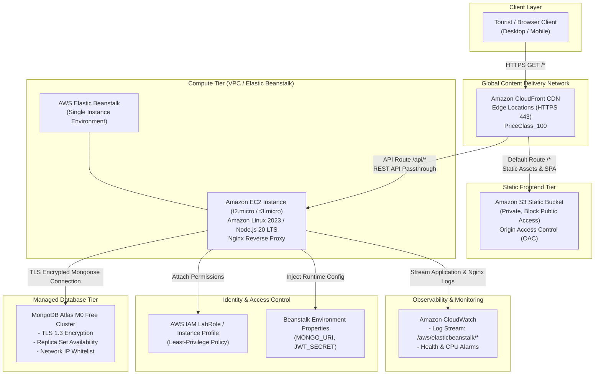

# AWS Cloud Architecture Documentation

## 1. System Overview

The **Smart Tourism Application** is a decoupled full-stack web system designed to deliver travel destination exploration and personalized tourism recommendations. The cloud architecture transforms a monolithic local development setup into a production-grade, highly available, secure, and cost-optimized deployment using Amazon Web Services (AWS) and MongoDB Atlas.

---

## 2. End-to-End Architecture Diagram

---

## 3. Component Deep Dive

### 3.1 Amazon CloudFront (Global CDN & Ingress Gateway)
- **Role**: Global edge caching, SSL/TLS termination, and unified ingress routing.
- **Routing Engine**:
  - `Default Behavior (/*)`: Directs requests to the Amazon S3 origin containing the built React single-page application.
  - `API Behavior (/api/*)`: Directs API calls straight to the Elastic Beanstalk environment. This creates a unified domain origin, completely eliminating Cross-Origin Resource Sharing (CORS) preflight latencies and complexity.
- **SPA Fallback Configuration**: Single-page applications handle routing client-side via React Router. Direct navigation to subpaths (e.g., `/explore`, `/recommend`) causes S3 to return `403 Forbidden` or `404 Not Found`. CloudFront Custom Error Responses rewrite `403` and `404` errors to `/index.html` with HTTP status `200 OK`, preserving client routes.
- **Security**: Forces HTTPS redirection (`redirect-to-https`) using CloudFront's default wildcard certificate (`*.cloudfront.net`).

### 3.2 Amazon S3 (Static Website Hosting)
- **Role**: Highly durable, low-cost storage for compiled static assets (`index.html`, JavaScript chunks, CSS stylesheets, SVGs).
- **Security & Privacy**:
  - **Block Public Access**: Fully enabled on all 4 settings (BlockPublicAcls, IgnorePublicAcls, BlockPublicPolicy, RestrictPublicBuckets). The bucket is completely private.
  - **Origin Access Control (OAC)**: Replaces legacy Origin Access Identities (OAI). The S3 bucket policy strictly permits `s3:GetObject` only when requested by CloudFront's service principal with a matching Source ARN condition.

### 3.3 AWS Elastic Beanstalk & Amazon EC2 (Compute Tier)
- **Role**: PaaS orchestration of the Node.js / Express backend application.
- **Underlying Infrastructure**: An Amazon EC2 instance (`t2.micro` or `t3.micro`) provisioned automatically with Amazon Linux 2023, Node.js 20 LTS runtime, and an Nginx reverse proxy.
- **Environment Architecture**: Configured as a **Single-Instance** environment without an Application Load Balancer (ALB). This design choice saves approximately \$18/month in university learner environments while maintaining total functional demonstration capabilities.
- **Reverse Proxy Architecture**: Nginx listens on port 80/443 and forwards incoming requests to the Node.js application process listening on port 5000 (specified in `.ebextensions/01_app.config`).

### 3.4 Amazon CloudWatch (Logging & Monitoring)
- **Log Collection**: Application stdout/stderr logs and Nginx access/error logs are automatically collected and streamed to CloudWatch Log Groups under `/aws/elasticbeanstalk/smart-tourism-api/`.
- **Metrics**: Tracks instance CPU utilization, network I/O, and HTTP 4xx/5xx error counts.
- **Health Checks**: Elastic Beanstalk queries the application's `/health` endpoint every 15 seconds. If the endpoint responds with HTTP 200, the instance status remains `Ok` (Green).

### 3.5 AWS IAM (Identity & Access Management)
- **Instance Profile**: Under AWS Academy Learner Lab environments, the pre-configured `LabRole` is attached to the EC2 instance profile.
- **Permissions**: Grants access to CloudWatch Logs (`logs:PutLogEvents`, `logs:CreateLogStream`) and Systems Manager Parameter Store.

### 3.6 MongoDB Atlas (Managed Data Tier)
- **Role**: Cloud-hosted document database storing user accounts, destination catalogs, and recommendation questionnaires.
- **Resilience**: Managed 3-node replica set with automated failover.
- **Security**: Enforced TLS/SSL encryption in transit, scram-sha-1/256 credential authentication, and IP network access list restriction.

---

## 4. Request & Data Flow Analysis

### Scenario A: Tourist Browsing Destinations (Static & Cached)
1. Browser requests `https://<domain>.cloudfront.net/explore`.
2. CloudFront checks edge cache:
   - If cached: Returns static asset directly in `< 20ms`.
   - If not cached: Fetches `/index.html` from S3 via OAC, caches it, and serves to user.
3. React application boots in browser and triggers `GET /api/places`.
4. CloudFront forwards `/api/places` to the Elastic Beanstalk Node.js backend.
5. Express queries MongoDB Atlas `places` collection and returns JSON.

### Scenario B: Generating Travel Recommendations (Dynamic Decision Tree)
1. Tourist fills questionnaire: Interest = "nature", Budget = "low", Group = "solo".
2. Frontend issues `POST /api/recommend` with answers payload.
3. Node.js backend executes the 3-step fallback decision tree algorithm:
   - Step 1: Strict match on category, budgetLevel, and bestFor.
   - Step 2: Fallback to category and bestFor if no strict match exists.
   - Step 3: Fallback to category only.
4. Recommendation request and returned destination IDs are persisted to MongoDB `questionnaires` collection for travel analytics.
5. JSON response is returned to frontend, which renders destination cards and badges.

---

## 5. Scalability, Availability & Trade-Offs

| Decision | Chosen Implementation | Production Alternative | Justification for Academic Context |
| :--- | :--- | :--- | :--- |
| **Compute Topology** | Single-Instance EC2 via Beanstalk | Multi-AZ Auto Scaling Group + ALB | Avoids \$18+/month ALB costs; ideal for student budgets and demonstrations. |
| **Database** | MongoDB Atlas M0 Free Tier | Amazon DocumentDB or DynamoDB | DocumentDB minimum cost is ~$0.27/hr (~$194/month); Atlas M0 is 100% free and native to Mongoose. |
| **Edge Distribution** | CloudFront PriceClass_100 | CloudFront PriceClass_All | Restricting edge locations to North America & Europe optimizes data transfer costs while providing global CDN benefits. |
| **API Domain** | CloudFront unified path `/api/*` | Separate API subdomain + Route 53 | Eliminates Route 53 hosted zone fees (\$0.50/month) and CORS configuration complexity. |
