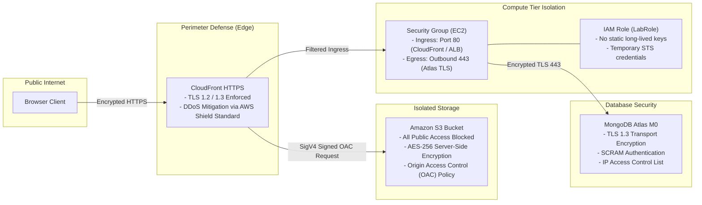

# Security Architecture & IAM Design

## 1. Security Philosophy

The Smart Tourism cloud architecture applies the **Defense in Depth** principle and the **Principle of Least Privilege**. Every layer—from edge delivery down to data persistence—enforces distinct security boundaries to protect user data, API endpoints, and cloud infrastructure.

---

## 2. Security Boundaries & Threat Modeling

---

## 3. Layer-by-Layer Security Controls

### 3.1 Edge Security (Amazon CloudFront)
- **HTTPS Enforcement**: All incoming HTTP traffic is forced to HTTPS via CloudFront's `redirect-to-https` viewer protocol policy.
- **Protocol Versions**: Configured for HTTP/2 and HTTP/3 with TLS 1.2 minimum security protocols.
- **DDoS Protection**: Inherits automatic AWS Shield Standard protection at no additional cost, mitigating Layer 3/4 network floods and SYN attacks.

### 3.2 Storage Security (Amazon S3)
- **Zero Public Access**: The `PublicAccessBlockConfiguration` blocks public ACLs, policies, and bucket searches.
- **Origin Access Control (OAC)**: Requests to S3 must bear a SigV4 signature generated by CloudFront. Direct access using the S3 HTTP endpoint returns HTTP `403 AccessDenied`.
- **At-Rest Encryption**: All static assets in S3 are encrypted at rest using AWS managed server-side encryption (`AES256`).

### 3.3 Compute & Network Security (Elastic Beanstalk / EC2)
- **No Hardcoded AWS Keys**: The application uses IAM Instance Profiles (`LabRole`). It never stores `AWS_ACCESS_KEY_ID` or `AWS_SECRET_ACCESS_KEY` in source code or configuration files.
- **EC2 Security Groups**:
  - Ingress: Restricts inbound traffic strictly to standard web ports (80/443).
  - Egress: Permits outbound access over port 443 only for Mongoose database connections, CloudWatch log streams, and package installations.
- **Reverse Proxy Shielding**: Node.js does not bind directly to the public network. An Nginx reverse proxy buffers incoming requests, handles slowloris attacks, and proxies requests locally to Node.js on port 5000.

### 3.4 Secret Management Strategy
- **Zero Secrets in Git**: The root `.gitignore` explicitly excludes `.env`, `*.log`, and deployment zip archives.
- **Packaging Security**: The deployment packager (`scripts/package-backend.ps1` / `.sh`) verifies and strips any `.env` files from the output zip artifact before compression.
- **Runtime Injection**: Sensitive values (`MONGO_URI`, `JWT_SECRET`) are injected securely at runtime through Elastic Beanstalk Environment Properties, which are encrypted in flight and at rest.

### 3.5 Application-Level Security
- **Authentication**: Stateless JSON Web Tokens (JWT) signed with HMAC-SHA256 and verified on every protected route.
- **Password Protection**: Passwords are salted and hashed using `bcryptjs` (salt rounds: 10) before storage. Plaintext passwords are never logged or stored.
- **Role-Based Access Control (RBAC)**: Destructive destination modifications (`POST /api/admin/places`, `DELETE /api/admin/places/:id`) require both `protect` (valid JWT) and `adminOnly` (`role === 'admin'`) middleware checks.
- **Sanitized Error Responses**: In production (`NODE_ENV === 'production'`), error stack traces are stripped to prevent internal directory paths or implementation details from leaking to callers.
